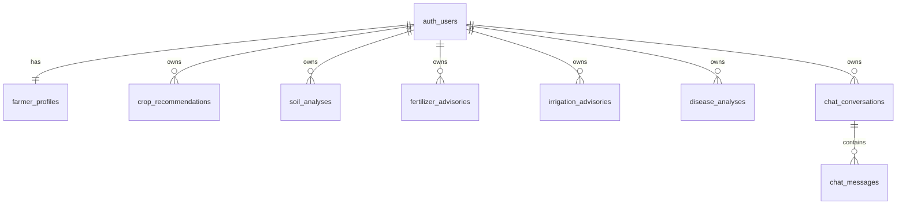

# Database Architecture: Krishi Mitra AI

Platform: **PostgreSQL 15+ / Supabase**

All tables use `UUID` primary keys generated by `gen_random_uuid()` and timestamps stored in UTC (`TIMESTAMPTZ NOT NULL DEFAULT NOW()`).

---

## 1. Schema Entity Relationship



---

## 2. Table Specifications

### 2.1 `farmer_profiles`
Stores farmer demographic and regional preferences.
- `id`: `UUID PRIMARY KEY REFERENCES auth.users(id) ON DELETE CASCADE`
- `full_name`: `TEXT NOT NULL`
- `state`: `TEXT`
- `district`: `TEXT`
- `village`: `TEXT`
- `preferred_language`: `TEXT NOT NULL DEFAULT 'en' CHECK (preferred_language IN ('en', 'kn', 'hi'))`
- `created_at`: `TIMESTAMPTZ`
- `updated_at`: `TIMESTAMPTZ`

### 2.2 `crop_recommendations`
Stores seasonal crop suitability evaluations.
- `id`: `UUID PRIMARY KEY DEFAULT gen_random_uuid()`
- `user_id`: `UUID NOT NULL REFERENCES auth.users(id) ON DELETE CASCADE`
- `location`: `JSONB NOT NULL` (state, district, village)
- `soil_data`: `JSONB NOT NULL` (soilType, soilPH, NPK, nutrientUnit)
- `farming_data`: `JSONB NOT NULL` (landArea, landUnit, irrigation, season, previousCrop)
- `ai_result`: `JSONB NOT NULL` (structured Gemini output)
- `model_name`: `TEXT`
- `prompt_version`: `TEXT`
- `created_at`: `TIMESTAMPTZ`

### 2.3 `soil_analyses`
Stores digitized laboratory soil reports.
- `id`: `UUID PRIMARY KEY DEFAULT gen_random_uuid()`
- `user_id`: `UUID NOT NULL REFERENCES auth.users(id) ON DELETE CASCADE`
- `soil_type`: `TEXT NOT NULL`
- `ph`: `NUMERIC(4,2)`
- `nitrogen`: `NUMERIC`
- `phosphorus`: `NUMERIC`
- `potassium`: `NUMERIC`
- `nutrient_unit`: `TEXT`
- `organic_carbon`: `NUMERIC`
- `electrical_conductivity`: `NUMERIC`
- `soil_test_date`: `DATE`
- `ai_result`: `JSONB NOT NULL`
- `created_at`: `TIMESTAMPTZ`

### 2.4 `fertilizer_advisories`
Stores crop growth-stage nutrient management plans.
- `id`: `UUID PRIMARY KEY DEFAULT gen_random_uuid()`
- `user_id`: `UUID NOT NULL REFERENCES auth.users(id) ON DELETE CASCADE`
- `crop_name`: `TEXT NOT NULL`
- `growth_stage`: `TEXT NOT NULL`
- `soil_data`: `JSONB`
- `land_area`: `NUMERIC NOT NULL`
- `land_unit`: `TEXT NOT NULL`
- `previous_fertilizer`: `TEXT`
- `ai_result`: `JSONB NOT NULL`
- `created_at`: `TIMESTAMPTZ`

### 2.5 `irrigation_advisories`
Stores water budgeting and conservation guidance.
- `id`: `UUID PRIMARY KEY DEFAULT gen_random_uuid()`
- `user_id`: `UUID NOT NULL REFERENCES auth.users(id) ON DELETE CASCADE`
- `crop_name`: `TEXT NOT NULL`
- `growth_stage`: `TEXT NOT NULL`
- `soil_type`: `TEXT NOT NULL`
- `irrigation_method`: `TEXT NOT NULL`
- `water_availability`: `TEXT NOT NULL`
- `environmental_data`: `JSONB`
- `ai_result`: `JSONB NOT NULL`
- `created_at`: `TIMESTAMPTZ`

### 2.6 `disease_analyses`
Stores image-based plant pathology diagnoses.
- `id`: `UUID PRIMARY KEY DEFAULT gen_random_uuid()`
- `user_id`: `UUID NOT NULL REFERENCES auth.users(id) ON DELETE CASCADE`
- `crop_name`: `TEXT NOT NULL`
- `growth_stage`: `TEXT`
- `symptoms`: `TEXT`
- `image_path`: `TEXT`
- `ai_result`: `JSONB NOT NULL`
- `created_at`: `TIMESTAMPTZ`

### 2.7 `chat_conversations` & `chat_messages`
Stores multi-turn conversational consultations with Krishi Mitra.

### 2.8 `advisory_sources`
Public reference table of certified agricultural institutions (ICAR, IMD, DPPQ&S, SAUs).

---

## 3. Row Level Security (RLS) Rules

Every user-owned table has Row Level Security enabled:
```sql
ALTER TABLE public.crop_recommendations ENABLE ROW LEVEL SECURITY;
```
Access is strictly gated to `auth.uid() = user_id`. No authenticated user can access, query, or mutate another farmer's data under any circumstance.

